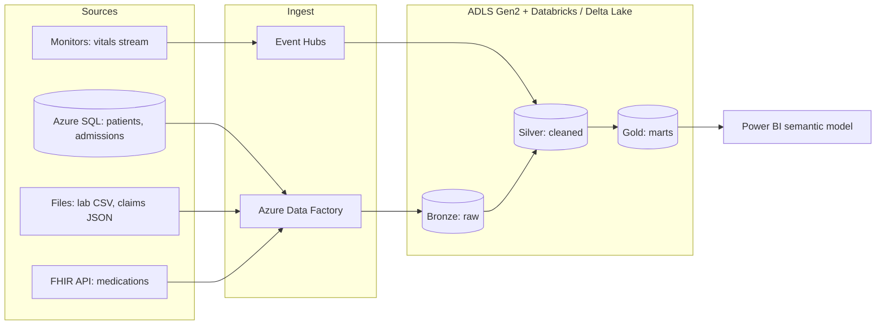

# Patient 360 — Senior Data Engineer Demo (Azure + Databricks)

End-to-end healthcare data platform, built from scratch as a portfolio / POC / interview demo.
Batch + streaming, medallion architecture, PySpark + Python, Power BI semantic model.

## Use case

A hospital wants one view of each patient: who they are, their admissions, lab results,
claims, medications, and live vitals from bedside monitors — plus a readmission-risk
dashboard for care teams.

**Question it answers:** for any patient, what happened, what is happening now, and
what is likely to happen next?

## Architecture



## Stack

| Layer | Technology |
|---|---|
| Storage | ADLS Gen2, Delta Lake |
| Compute | Azure Databricks (Spark, PySpark, Python) |
| Batch ingestion | Azure Data Factory, JDBC, REST |
| Streaming | Event Hubs, Structured Streaming |
| Warehouse | Databricks SQL / Synapse (Gold) |
| BI | Power BI semantic model |
| Security | Key Vault, Microsoft Purview, PHI masking |

## Repo structure

```
patient360-de-demo/
  data/            sample data (synthetic, no real PHI)
    file/          lab_results.csv, claims.json
    table/         patients.csv, admissions.csv, admissions.sql (Azure SQL DDL + seed)
    api/           fhir_medication_requests.json (FHIR R4 bundle)
    stream/        vitals.jsonl
  src/ingestion/   Python ingestion: file, table (JDBC), API
  notebooks/       Databricks notebooks: Bronze, Silver, Gold
  streaming/       Structured Streaming vitals pipeline
  powerbi/         semantic model design + DAX measures
  docs/            architecture + data dictionary
  infra/           Azure resources + ADF pipeline notes
```

## Sample data (all synthetic, same patient IDs across sources)

| Dataset | Rows | Source type | File |
|---|---|---|---|
| patients | 200 | Table (Azure SQL) | data/table/patients.csv |
| admissions | 350 | Table (Azure SQL) | data/table/admissions.csv |
| lab_results | 1,500 | File (CSV) | data/file/lab_results.csv |
| claims | 400 | File (JSON) | data/file/claims.json |
| medications | 300 | API (FHIR R4) | data/api/fhir_medication_requests.json |
| vitals | 600 | Stream (JSONL) | data/stream/vitals.jsonl |

Every dataset joins on `patient_id`. See [docs/data-dictionary.md](docs/data-dictionary.md).

## Build steps (one at a time)

1. Create the repo + folder structure
2. Add the sample data
3. Architecture doc + README
4. Bronze ingestion (table, file, API)
5. Silver transforms in PySpark
6. Streaming vitals pipeline
7. Gold marts (Patient 360)
8. Power BI semantic model

## How to demo it (5 minutes)

1. Show the architecture diagram and the three ingestion methods.
2. Run Bronze ingestion: one table, one file, one API call land in Delta.
3. Show a Silver notebook: dedupe, standardize, data-quality checks.
4. Show the vitals stream landing in near-real time.
5. Open Power BI: Patient 360 page, readmission-risk page, one DAX measure explained.

## Interview talking points

- Why medallion: raw fidelity in Bronze, trusted conformed data in Silver, business-ready marts in Gold.
- Why Delta Lake: ACID, time travel, schema enforcement, merge/upserts.
- Batch vs streaming: same Silver/Gold logic, different triggers; Structured Streaming with watermarks for late vitals.
- PHI: no real data in the demo; in production, Purview classification + column masking + Key Vault secrets.
- Idempotency: every load is re-runnable by business key + load date; no duplicates on retry.
